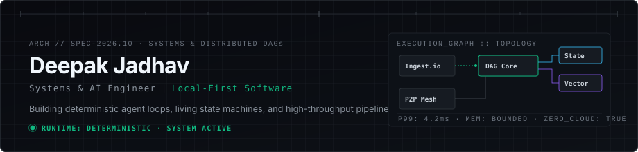

  

# Deepak Jadhav
Computer Science & AI · Autonomous Systems Infrastructure · Independent Software Builder

  <a href="https://deepxkjadhav.github.io/">Portfolio</a> &nbsp;·&nbsp;
  <a href="mailto:deepak.s.jadhav07@gmail.com">Email</a> &nbsp;·&nbsp;
  <a href="https://linkedin.com/in/deepak-jadhav">LinkedIn</a> &nbsp;·&nbsp;
  <a href="https://github.com/DeepxkJadhav">GitHub</a>

---

### Focus & Philosophy

I like working on the parts of software that are usually hidden: the autonomous loop that lets an agent act reliably, the state engine that makes computational tools recoverable, and the topology that makes complex distributed systems observable.

Most of my work centers around **autonomous agent execution, developer infrastructure, multimodal retrieval, and applied machine learning**. I build systems to understand how they behave under real execution constraints outside a demo sandbox.

---

### Selected Systems & Field Specimens

| System | Exploration & Discipline | Architecture & Approach | Core Stack |
| :--- | :--- | :--- | :--- |
| [**Arachne**](https://github.com/DeepxkJadhav/Arachne) | **Terminal-First Web Intelligence** | Coordinated discovery, extraction, verification, and synthesis pipeline compiling queries into source-backed research dossiers. | `TypeScript` · `Node.js` · `Chrome CDP` · `SQLite WAL` |
| [**Chrono**](https://github.com/DeepxkJadhav/ChronoExtension) | **Continuous Living State Engine** | Flight recorder capturing computational state between git commits. Uses content-addressed causal graphs for speculative branches and rewind. | `TypeScript` · `SQLite` · `Causal DAGs` · `VS Code API` |
| [**Sentient**](https://github.com/DeepxkJadhav/Sentient-UI) | **Autonomous Agent Infrastructure** | Reusable harness for agent workflows: dynamic task routing, specialist subagents, context retention, and multi-agent coordination. | `TypeScript` · `Python` · `MCP Tools` · `Swarm Orch` |
| [**TopoChain**](https://github.com/DeepxkJadhav/topochain) | **Software Supply-Chain Integrity** | Structural drift detection combining AST parsing, dependency intelligence, and persistent-homology topological data analysis. | `Python` · `AST` · `Ripser` · `Persim` · `PyTorch` |
| [**VoxTrace**](https://github.com/DeepxkJadhav/VoxTrace) | **Multimodal Audio Intelligence** | Searchable audio memory system featuring timestamped speech transcription and sub-second dense vector similarity search. | `Python` · `Whisper` · `Sentence Transformers` · `FAISS` · `FastAPI` |
| [**SynapseGrid**](https://github.com/DeepxkJadhav/SYNAPSE-GRID) | **Real-Time Collaborative Workspace** | Multi-tenant collaborative development environment built around CRDT synchronization and isolated execution containers. | `Next.js` · `Yjs CRDT` · `Monaco Editor` · `Docker` |

---

### Current Research & Systems Focus

- **Computer-Use Agent Loops:** Designing autonomous execution agents that observe interface state, ground actions accurately, and verify side effects.
- **Durable Computational State Models:** Investigating local-first state capture and causal graph recovery across runtime failures.
- **Topological Integrity & Graph Drift:** Applying topological data analysis (TDA) to code dependency graphs to detect unauthorized supply-chain perturbations.
- **Multimodal Retrieval & Grounding:** Low-latency vector memory architectures connecting audio/visual perception to deterministic execution tools.

---

### Core Technical Tooling

`Python` &nbsp;·&nbsp; `TypeScript` &nbsp;·&nbsp; `JavaScript` &nbsp;·&nbsp; `C/C++` &nbsp;·&nbsp; `React` &nbsp;·&nbsp; `Next.js` &nbsp;·&nbsp; `FastAPI` &nbsp;·&nbsp; `PyTorch` &nbsp;·&nbsp; `SQLite` &nbsp;·&nbsp; `Docker` &nbsp;·&nbsp; `Playwright` &nbsp;·&nbsp; `FAISS` &nbsp;·&nbsp; `Three.js`

---

### Background & Credentials

- **Degree:** B.Tech, Computer Science & Engineering (Artificial Intelligence) · Parul University · Expected 2027
- **Certifications:** AWS Certified Cloud Practitioner &nbsp;·&nbsp; IBM AI Engineering Professional Certificate

---

  <i>"I prefer systems you can inspect over demos you can only watch."</i>

