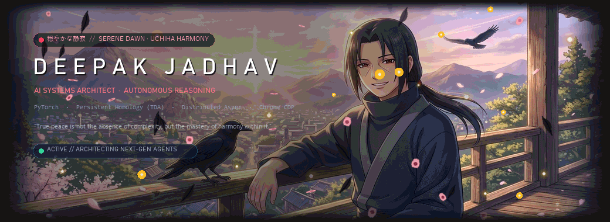
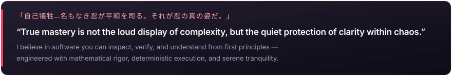
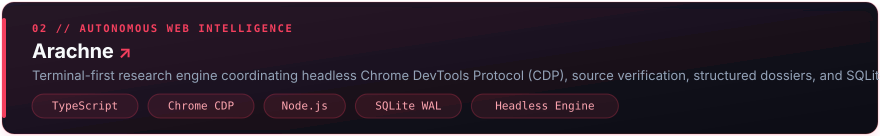
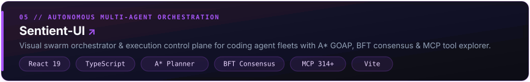
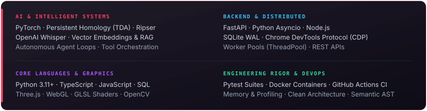

<!-- Hero Animated Banner: Calm & Joyful Itachi at Dawn -->

 

<!-- Sleek Twilight Navigation Badges -->

&nbsp;

&nbsp;

&nbsp;

  

<!-- Tranquil Crow Twilight Divider Animation -->

  

<!-- Philosophy & Perspective -->

  

<!-- Section 01: Flagship Systems -->

  

<!-- Flagship 01: TopoChain -->

 

<!-- Flagship 02: Arachne -->

 

<!-- Flagship 03: VoxTrace -->

 

<!-- Flagship 04: CYPH3R -->

 

<!-- Flagship 05: Sentient-UI -->

 

<!-- Flagship 06: Chrono State Engine -->

 

<!-- Flagship 06: Interactive 3D Experience -->

  

<!-- Tranquil Crow Twilight Divider Animation -->

  

<!-- Section 02: Core Technical Arsenal -->

  

<!-- Technical Arsenal Grid Card -->

  

<!-- Tranquil Footer -->
<i>"True peace is not the absence of complexity, but the mastery of harmony within it."</i>
 
Deepak Jadhav (Deepxk) · Architecting Autonomous Intelligence · Stillness & Rigor

