<div align="center">

<!-- ========================================== -->
<!-- ✦ CINEMATIC 3D HOLOGRAPHIC HERO BANNER ✦ -->
<!-- ========================================== -->
<p align="center">
  <a href="https://DeepxkJadhav.github.io/">
    
  </a>
</p>

<!-- Interactive 3D World Launch Portal -->
<p align="center">
  <a href="https://DeepxkJadhav.github.io/">
    
  </a>
  <a href="https://github.com/DeepxkJadhav?tab=repositories">
    
  </a>
</p>

<p align="center">
  <sub>✦ <b>Click the 3D Hologram or the portal button above to launch the live interactive WebGL 3D experience with orbit controls!</b> ✦</sub>
</p>

---

</div>

## ⬡ 01 // ARCHITECTURAL TELEMETRY

```
┌── SYS://CORE.DEEPAK.AI ────────────────────────────────────────────────────────┐
│ [STATUS] : ONLINE (STABLE)        [RUNTIME] : LOCAL-FIRST & DETERMINISTIC      │
│ [FOCUS]  : AUTONOMOUS AGENTS      [GRAPH]   : REACTIVE MULTIMODAL DAG          │
│ [SYSTEM] : HIGH-CONCURRENCY       [ENGINE]  : THREE.JS • PYTORCH • FASTAPI     │
└────────────────────────────────────────────────────────────────────────────────┘
```

I build **autonomous agent architectures, living computational state engines, and real-time multimodal intelligence systems**. My mission is unifying bleeding-edge neural models with high-throughput, low-latency, deterministic software engineering.

* 🤖 **Autonomous Agent Swarms:** Terminal-first research engines, multi-source knowledge synthesis, and self-directing execution environments.
* ⏳ **Living Computational State:** Zero-overhead continuous execution telemetry, time-travel debugging, and local-first branch speculative DAGs.
* 🎙️ **Multimodal Neural Pipelines:** Streaming audio-to-text with Whisper, dense embedding indexing with FAISS, and high-concurrency FastAPI backends.
* ⚡ **Spatial & Generative 3D:** Procedural character rigging, WebGL/Three.js interactive workspaces, and neural 2D-to-3D asset synthesis.

---

## ⬡ 02 // FLAGSHIP ARCHITECTURES

<div align="center">

| System | Architecture | Description | Stack | Telemetry |
| :--- | :--- | :--- | :--- | :---: |
| [**Arachne**](https://github.com/DeepxkJadhav/Arachne) | **Autonomous Research** | Terminal-first autonomous web intelligence & deep research CLI engine with multi-source evidence synthesis. | `Python` `Agents` `CLI` | [](https://github.com/DeepxkJadhav/Arachne) |
| [**Chrono**](https://github.com/DeepxkJadhav/ChronoExtension) | **Living State Engine** | Living computational state machine with continuous time travel, speculative execution, and local-first DAGs. | `TypeScript` `DAG` `State` | [](https://github.com/DeepxkJadhav/ChronoExtension) |
| [**MeetFlow AI**](https://github.com/DeepxkJadhav/meetflow-ai) | **Browser Automation & AI** | Autonomous meeting attendance, real-time transcription, and automated participation engine. | `Python` `Playwright` `FastAPI` | [](https://github.com/DeepxkJadhav/meetflow-ai) |
| [**VoxTrace**](https://github.com/DeepxkJadhav/VoxTrace) | **Multimodal Audio AI** | End-to-end multimodal audio pipeline: Whisper transcription, FAISS semantic vector retrieval, and fast API delivery. | `FastAPI` `Whisper` `FAISS` | [](https://github.com/DeepxkJadhav/VoxTrace) |
| [**Model Studio**](https://github.com/DeepxkJadhav/ModelStudio) | **Spatial & 3D Rigging** | AI 2D-to-3D asset generation workspace with automated skeletal rigging and interactive Three.js rendering canvas. | `React` `Three.js` `TypeScript` | [](https://github.com/DeepxkJadhav/ModelStudio) |
| [**SyncMesh**](https://github.com/DeepxkJadhav/SyncMesh) | **Distributed P2P Mesh** | Privacy-first zero-cloud offline clipboard and high-speed local network file synchronization. | `C#` `Android` `P2P` | [](https://github.com/DeepxkJadhav/SyncMesh) |

</div>

---

## ⬡ 03 // 3D ISOMETRIC ACTIVITY MATRIX

<div align="center">

```
>>> EXECUTING ISOMETRIC CONTRIBUTION RENDERER (AUTOMATED GITHUB ACTIONS WORKFLOW)
```

<!-- Automated 3D Isometric Contribution Graph (Generates automatically via .github/workflows/profile-3d.yml) -->
<picture>
  <source media="(prefers-color-scheme: dark)" srcset="./profile-3d-contrib/profile-night-rainbow.svg">
  <source media="(prefers-color-scheme: light)" srcset="./profile-3d-contrib/profile-green-animate.svg">
  
</picture>

</div>

---

## ⬡ 04 // ENGINEERED TOOLCHAIN & STACK

<div align="center">

### Core Systems & Native Architecture
<p>
  
  
  
  
  
  
</p>

### AI, Multimodal Intelligence & Vector Retrieval
<p>
  
  
  
  
  
  
</p>

### Spatial, WebGL & Interactive Creative Tech
<p>
  
  
  
  
  
</p>

### Distributed Infrastructure & Backend
<p>
  
  
  
  
  
  
</p>

</div>

---

## ⬡ 05 // LIVE TELEMETRY & ACTIVITY METRICS

<div align="center">
  <p align="center">
    
    
  </p>
  <p align="center">
    
  </p>
</div>

---

## ⬡ 06 // COMMS & NETWORK CHANNELS

<p align="center">
  <a href="mailto:deepak.s.jadhav07@gmail.com">
    
  </a>
  <a href="https://github.com/DeepxkJadhav">
    
  </a>
  <a href="https://linkedin.com/in/deepak-jadhav">
    
  </a>
  <a href="https://x.com/DeepxkJadhav">
    
  </a>
</p>

<p align="center">
  
</p>

<div align="center">
  <sub><code>sys:~$ ./dispatch --mode=innovate --precision=deterministic --3d=enabled</code></sub>
</div>
