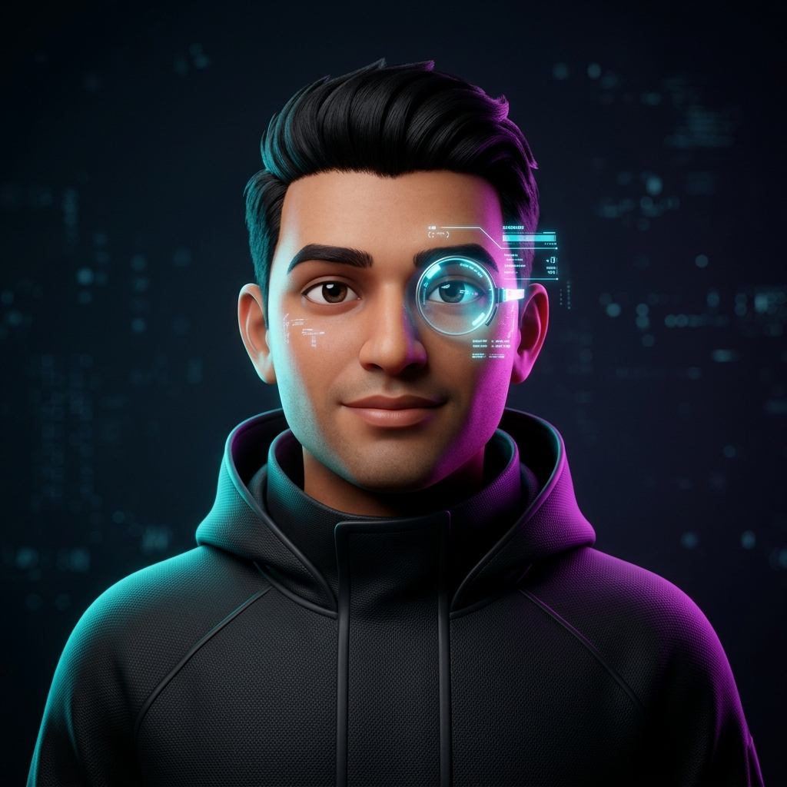

<!-- ═══════════════════════════════════════════════════════════════════════════ -->
<!-- ✦ CINEMATIC 3D HERO BANNER // NEURAL WORKSTATION ✦ -->
<!-- ═══════════════════════════════════════════════════════════════════════════ -->

  

<!-- ═══════════════════════════════════════════════════════════════════════════ -->
<!-- ✦ INTERACTIVE LAUNCH RIBBON ✦ -->
<!-- ═══════════════════════════════════════════════════════════════════════════ -->

  
  &nbsp;
  
  &nbsp;
  

✦ <i>Click the banner above to launch the live interactive WebGL 3D world with camera orbit controls & project beacons!</i> ✦

---

<!-- ═══════════════════════════════════════════════════════════════════════════ -->
<!-- ✦ BENTO GRID ROW 1: IDENTITY & LIVE TELEMETRY ✦ -->
<!-- ═══════════════════════════════════════════════════════════════════════════ -->

<table>
  <tr>
    <!-- BENTO 01: 3D AVATAR & EXECUTIVE PROFILE (62%) -->
    <td width="62%" valign="top">
      <table width="100%">
        <tr>
          <td width="150" align="center" valign="top">
            
             
            <code>CORE://DEEPAK.AI</code>
          </td>
          <td valign="top" style="padding-left: 14px;">
            <h3>Deepak Jadhav</h3>
            
<b>Systems &amp; AI Architect · Multimodal &amp; Spatial Engineer</b>

            

              Architecting <b>autonomous agent swarms</b>, <b>living state DAG machines</b>, and <b>high-concurrency multimodal pipelines</b>. Unifying cutting-edge machine intelligence with low-latency, deterministic software engineering.
            

            

              <code>SYS_STATUS</code> : 🟢 <b>Online · Open for Advanced Architecture &amp; R&amp;D Collaborations</b>
            

          </td>
        </tr>
      </table>
    </td>

    <!-- BENTO 02: LIVE GITHUB TELEMETRY (38%) -->
    <td width="38%" valign="middle" align="center">
      
    </td>
  </tr>
</table>

---

<!-- ═══════════════════════════════════════════════════════════════════════════ -->
<!-- ✦ BENTO GRID ROW 2: FLAGSHIP ARCHITECTURES ✦ -->
<!-- ═══════════════════════════════════════════════════════════════════════════ -->

### ⬡ FLAGSHIP ARCHITECTURES

<table>
  <!-- ROW 2A: ARACHNE & MEETFLOW AI -->
  <tr>
    <td width="50%" valign="top">
      <h4>🕷️ <a href="https://github.com/DeepxkJadhav/Arachne">Arachne</a> &nbsp; </h4>
      

        Terminal-first autonomous web intelligence &amp; deep research CLI engine. Deploys multi-agent reasoning graphs, recursive evidence extraction, and cross-source intelligence synthesis.
      

      <code>Python</code> · <code>Autonomous Agents</code> · <code>CLI</code> · <code>Synthesis</code>
    </td>

    <td width="50%" valign="top">
      <h4>🤖 <a href="https://github.com/DeepxkJadhav/meetflow-ai">MeetFlow AI</a> &nbsp; </h4>
      

        Autonomous meeting intelligence and browser automation engine. Powers headless meeting presence, real-time transcription, contextual attendance, and automated scheduled task workflows.
      

      <code>Python</code> · <code>Playwright</code> · <code>FastAPI</code> · <code>Chromium CDP</code>
    </td>
  </tr>

  <!-- ROW 2B: CHRONO & VOXTRACE -->
  <tr>
    <td width="50%" valign="top">
      <h4>⏳ <a href="https://github.com/DeepxkJadhav/ChronoExtension">Chrono</a> &nbsp; </h4>
      

        Time machine for code &amp; living computational state. Continuous zero-overhead background telemetry recording, one-click time travel, and local-first speculative branch DAGs.
      

      <code>TypeScript</code> · <code>Local-First</code> · <code>DAG</code> · <code>State Engine</code>
    </td>

    <td width="50%" valign="top">
      <h4>🎙️ <a href="https://github.com/DeepxkJadhav/VoxTrace">VoxTrace</a> &nbsp; </h4>
      

        End-to-end multimodal audio intelligence pipeline: raw audio ingestion, timestamped Whisper transcription, dense FAISS semantic vector search, and high-throughput FastAPI inference.
      

      <code>FastAPI</code> · <code>OpenAI Whisper</code> · <code>FAISS</code> · <code>PyTorch</code>
    </td>
  </tr>

  <!-- ROW 2C: MODEL STUDIO & SYNCMESH -->
  <tr>
    <td width="50%" valign="top">
      <h4>⚡ <a href="https://github.com/DeepxkJadhav/ModelStudio">Model Studio</a> &nbsp; </h4>
      

        AI-assisted 2D-to-3D asset generation and creative workspace with automated skeletal rigging, morph target blending, and interactive real-time Three.js canvas rendering.
      

      <code>Three.js</code> · <code>React</code> · <code>Vite</code> · <code>TypeScript</code> · <code>WebGL</code>
    </td>

    <td width="50%" valign="top">
      <h4>🧩 <a href="https://github.com/DeepxkJadhav/SyncMesh">SyncMesh</a> &nbsp; </h4>
      

        Privacy-first, zero-cloud clipboard and high-speed file synchronization mesh over local Wi-Fi and hotspots across Android, Windows, and macOS devices.
      

      <code>C#</code> · <code>Android</code> · <code>Local Mesh</code> · <code>Zero-Cloud P2P</code>
    </td>
  </tr>
</table>

---

<!-- ═══════════════════════════════════════════════════════════════════════════ -->
<!-- ✦ BENTO GRID ROW 3: ARSENAL & SKILLS ✦ -->
<!-- ═══════════════════════════════════════════════════════════════════════════ -->

### ⬡ ENGINEERED ARSENAL

<table>
  <tr>
    <td width="25%" valign="top">
      <b>Core Systems</b>  
      • Python 3.12+ 
      • TypeScript / JS 
      • Rust 
      • C# / .NET 
      • C++ 
      • SQL / SQLite 
      • Bash / PowerShell
    </td>

    <td width="25%" valign="top">
      <b>AI &amp; Multimodal</b>  
      • PyTorch 
      • OpenAI Whisper 
      • FAISS Vector Search 
      • Transformers (HF) 
      • LangChain / Agents 
      • Ollama Local LLMs 
      • Semantic Embeddings
    </td>

    <td width="25%" valign="top">
      <b>Spatial &amp; Frontend</b>  
      • Three.js / WebGL 
      • React 18 / Next.js 
      • Vite / TailwindCSS 
      • 3D Skeletal Rigging 
      • HTML5 Canvas 
      • Shader Programming 
      • Interactive WebGL
    </td>

    <td width="25%" valign="top">
      <b>Infra &amp; Automation</b>  
      • Playwright (Async) 
      • FastAPI / Uvicorn 
      • Docker Containers 
      • Redis In-Memory 
      • Chromium CDP 
      • GitHub Actions CI/CD 
      • Linux Systems
    </td>
  </tr>
</table>

---

<!-- ═══════════════════════════════════════════════════════════════════════════ -->
<!-- ✦ BENTO GRID ROW 4: ACTIVITY & CONTRIBUTION GRAPH ✦ -->
<!-- ═══════════════════════════════════════════════════════════════════════════ -->

### ⬡ COMMIT STREAK &amp; MATRIX

  
  &nbsp;&nbsp;
  

<!-- 3D Isometric Contribution City Graph (via profile-3d-contrib) -->
<picture>
  <source media="(prefers-color-scheme: dark)" srcset="./profile-3d-contrib/profile-night-rainbow.svg">
  <source media="(prefers-color-scheme: light)" srcset="./profile-3d-contrib/profile-green-animate.svg">
  
</picture>

---

<!-- ═══════════════════════════════════════════════════════════════════════════ -->
<!-- ✦ BENTO GRID ROW 5: DIRECT CHANNELS ✦ -->
<!-- ═══════════════════════════════════════════════════════════════════════════ -->

### ⬡ DIRECT TRANSMISSION CHANNELS

  
  &nbsp;
  
  &nbsp;
  
  &nbsp;
  

  

<code>sys:~$ ./dispatch --mode=innovate --model=3d_neural --velocity=maximum</code>

