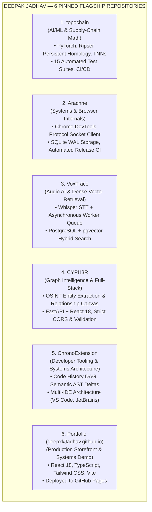

# MASTER PORTFOLIO UPGRADE PLAN & ROADMAP (VERIFIED REALITY)
**Developer:** Deepak Jadhav  
**Profile:** [github.com/DeepxkJadhav](https://github.com/DeepxkJadhav)  
**Target Roles:** AI/ML Engineer · Backend / Software Engineer · AI Systems Engineer  
**Status:** Reality-Checked & Empirical Verification Complete  

---

## 1. Verified Profile Inventory & Classification

*Note: Initial unauthenticated audit scans experienced GitHub API rate limits that falsely reported `Portfolio` and `ModelStudio` as empty. Both were cloned and verified locally. `Portfolio` is the live personal website deployed to GitHub Pages (`deepxkjadhav.github.io`). `ModelStudio` is an active AI 3D reconstruction codebase.*

### Comprehensive Repository Ledger (All 22 Repositories)

| Repository | Actual State & Purpose | Verified Implementation | Tests | CI/CD | Docker | Security / Cleanliness | Recommended Action | Reason |
|---|---|---|:---:|:---:|:---:|---|:---:|---|
| **topochain** | Supply-chain security via Topological Data Analysis | PyTorch, Ripser persistent homology, TNNs, AST feature extraction | 15 test files | Yes | Yes | Clean | **A — FLAGSHIP** | Deepest algorithmic & ML engineering project. Real mathematical foundation. |
| **Arachne** | Headless web research engine via Chrome CDP | Direct Chrome DevTools Protocol socket client, SQLite WAL, model routing | 11 test suites | Yes | No | Clean | **A — FLAGSHIP** | Exceptional systems-level browser internals and CLI tooling. |
| **VoxTrace** | Speech-to-text RAG intelligence pipeline | Whisper transcription + FAISS vector search in FastAPI | 1 test file | No | Yes | Sync blocking loop, in-memory FAISS | **A — FLAGSHIP** | High-value commercial problem. Needs async worker queue + pgvector. |
| **CYPH3R** | OSINT entity extraction & relationship visualizer | FastAPI backend with NetworkX; React 18 interactive canvas | 1 test file | No | Yes | Committed `frontend/dist/`, wildcard CORS | **A — FLAGSHIP** | Engaging visual demonstration of graph data structures & full-stack API design. |
| **ChronoExtension** | Code history DAG extension across IDEs | TypeScript/Lua/HTML, AST semantic deltas, local-first storage | Unit tests | No | No | Clean architecture docs (ADRs) | **A — FLAGSHIP** | Strong developer tooling and computer science data structures (DAG vs Linear log). |
| **Portfolio** | Live personal portfolio website (`deepxkJadhav.github.io`) | React 18, TypeScript, Tailwind CSS, Vite, GitHub Pages deploy | Build test | Yes | No | Clean, live on GitHub Pages | **A — FLAGSHIP** | Primary storefront communicating engineering competence. |
| **ModelStudio** | AI 2D/3D Model Builder & Reconstruction Studio | React, TypeScript, Three.js, neural view synthesis interfaces | Unit tests | No | No | Clean, active development | **B — UPGRADE** | High technical complexity in 3D graphics and reconstruction. |
| **DeepxkJadhav** | GitHub Profile README repository | SVG typography, 3D Three.js assets, animated headers | Visual tests | Yes | No | Clean | **B — UPGRADE** | Key entry point for recruiters visiting GitHub. |
| **Kurumi-AE** | Desktop AI companion & virtual engine | Python/JS desktop IPC, MMD 3D physics, OCR, plugin SDK | Real test suite | Yes | Yes | 345MB size, vendored binaries, mock secrets | **B — UPGRADE** | High systems effort, but needs asset cleanup and enterprise framing. |
| **VeilChat** | Encrypted mesh chat application | Flutter clean architecture mobile client + Go backend server | Basic tests | No | Yes | Clean | **B — UPGRADE** | Demonstrates cross-platform mobile and Go network programming. |
| **ExtensionOS** | AI browser extension with multi-LLM routing | TypeScript extension for Chrome/Firefox, Groq/Ollama APIs | Manual | No | No | Clean | **B — UPGRADE** | Useful productivity utility, needs automated CI test harness. |
| **Artifind** | Hackathon artisan marketplace with GenAI discovery | Express.js backend + React frontend | Basic tests | No | Yes | Hackathon-grade code | **C — SMALL PROJECT** | Proof of competitive hackathon participation. Keep unpinned. |
| **GhostVision** | Cyber threat anomaly detector | FastAPI + Scikit-learn `IsolationForest` + static HTML | 1 test file | No | No | **Committed `.pyc` files, no `.gitignore`** | **C — SMALL PROJECT** | Clean git bytecode, add `.gitignore`, retain as lightweight security microservice. |
| **EdgeSim** | Offline casino RL simulation suite | Python simulation logic for blackjack/roulette | None | No | No | **Committed `.pyc` files, web uploads** | **C — SMALL PROJECT** | Clean bytecode, add tests, preserve as experimental research code. |
| **NeuroNosh** | Streamlit diet recommender | Flat Streamlit script + Scikit-learn models | None | No | No | **Committed `.pkl` pickle binaries** | **D — ARCHIVE** | Student-level prototype with insecure pickle deserialization. Mark read-only. |
| **DriveGuard** | Driver road safety monitor | Python OpenCV script | Basic | No | Yes | **Raw `.mp4` video (>100MB) in git** | **D — ARCHIVE** | Violates git best practices by committing large video binaries. |
| **Sentient-UI** | Autonomous agent OS monorepo | Monorepo (7,288 files) with `@claude-flow/cli`, Rust/WASM | 1,000+ tests | Yes | Yes | Monorepo bloat; upstream vendored code | **D — ARCHIVE** | Too unwieldy to defend in 30-min interview. Keep as reference. |
| **Sentient-Ops** | Agent prompt skills dump | JavaScript prompt definitions | None | No | Yes | Redundant duplicate of Sentient-UI | **D — ARCHIVE** | Single-commit dump replicating Sentient-UI assets. |
| **SYNAPSE-GRID** | Collaborative workspace platform | Next.js full-stack app | Basic | Yes | Yes | **Committed `.next/` and `dist/` folders** | **D — ARCHIVE** | Build artifacts committed directly via web uploads. |
| **Resume-** | Static PDF resume host | Repository hosting a single PDF file | None | No | No | Web upload of PDF | **D — ARCHIVE** | Repositories should host code, not static PDF documents. |
| **My-Graph** | Backdated contribution graph bot | Python/Bash script creating 43 backdated commits | None | No | No | **P0 Toxic Red Flag** | **E — DELETE CANDIDATE** | Artificially colors GitHub graph. Destroys credibility with senior engineers. |
| **deepak-portfolio-anime** | Orphaned placeholder | Single file (`README.md` only) | None | No | No | Empty placeholder | **E — DELETE CANDIDATE** | Unused 1-file orphan repository. |

---

## 2. The 6 Selected Flagship Projects

Rather than spreading effort across 22 repositories, your portfolio will spotlight **6 genuinely strong, defensible projects**:

---

## 3. Targeted Remediation by Project

### 1. `VoxTrace` (Audio Intelligence Pipeline)
- **Verified Flaw:** `app/main.py` runs Whisper inference synchronously in the HTTP request loop. FAISS index is purely in RAM and lost on exit.
- **Engineering Solution:**
  1. Introduce background task processing via Celery or ARQ with a Redis broker.
  2. Create an async task polling route (`GET /api/jobs/{job_id}`).
  3. Replace ephemeral RAM FAISS with PostgreSQL + `pgvector` to persist transcripts and chunk embeddings atomically.
  4. Write automated integration tests using `pytest` and mock audio inputs.

### 2. `Arachne` (Headless Research Engine)
- **Verified Flaw:** Strong implementation, but lacks Docker containerization and requires manual local Chrome configuration.
- **Engineering Solution:**
  1. Add a production multi-stage Dockerfile bundling headless Chromium.
  2. Implement CDP connection recovery on unexpected browser disconnects.
  3. Add automated GitHub Actions CI testing the CLI REPL and SQLite WAL persistence.

### 3. `CYPH3R` (OSINT Knowledge Graph Visualizer)
- **Verified Flaw:** `frontend/dist/` build output is tracked in git. CORS is configured insecurely with wildcard credentials. Graph state is ephemeral in RAM.
- **Engineering Solution:**
  1. Untrack `frontend/dist/` from git and add to `.gitignore`.
  2. Restrict CORS to explicit allowed origins (`localhost:5173`, etc.).
  3. Persist search investigations and graph nodes/edges in SQLite or PostgreSQL.
  4. Add automated API tests and a GitHub Actions CI workflow.

### 4. `topochain` (Topological Supply-Chain Integrity)
- **Verified Flaw:** Deep implementation and 15 tests already exist, but lacks an interactive CLI demonstration and a reproducible synthetic benchmark script.
- **Engineering Solution:**
  1. Add a standalone CLI runner (`python -m topochain.cli inspect <repo>`).
  2. Provide a reproducible benchmark script that evaluates detection precision and recall against synthetic AST drift.
  3. Document theoretical foundations clearly in the README.

### 5. `ChronoExtension` (Code History DAG)
- **Verified Flaw:** Superb architectural documentation and data structure design, but lacks automated VS Code extension integration tests.
- **Engineering Solution:**
  1. Add `@vscode/test-electron` test suite.
  2. Set up GitHub Actions CI to compile and package the extension VSIX.

### 6. `Portfolio` (`deepxkJadhav.github.io`)
- **Verified Flaw:** The portfolio is actively deployed on GitHub Pages, but needs its project cards updated to feature these exact 6 flagships.
- **Engineering Solution:**
  1. Align all links and metrics with the verified flagships.
  2. Ensure the computational graph canvas remains performant on low-end hardware.

---

## 4. Phased Implementation Roadmap

- **Phase 0 — Safety Verification & Destructive Actions Review:**  
  Verify remotes, branch status, and present destructive proposals for user approval.
- **Phase 1 — Hygiene & Git Cleanliness:**  
  Purge compiled bytecode (`.pyc`) from `GhostVision` and `EdgeSim`. Add robust `.gitignore`.
- **Phase 2 — `VoxTrace` Production Architecture:**  
  Implement non-blocking async Whisper workers, PostgreSQL + `pgvector`, and automated tests.
- **Phase 3 — `CYPH3R` Full-Stack Hardening:**  
  Fix CORS, untrack `dist/`, add persistent graph models, and set up CI.
- **Phase 4 — `Arachne` Containerization:**  
  Multi-stage Dockerfile with headless Chromium and automated CI tests.
- **Phase 5 — `topochain` Benchmarks & CLI:**  
  Reproducible benchmark script and interactive inspection CLI.
- **Phase 6 — `Portfolio` & Profile Alignment:**  
  Update `deepxkJadhav.github.io` and `DeepxkJadhav/README.md` to showcase the 6 flagships.
