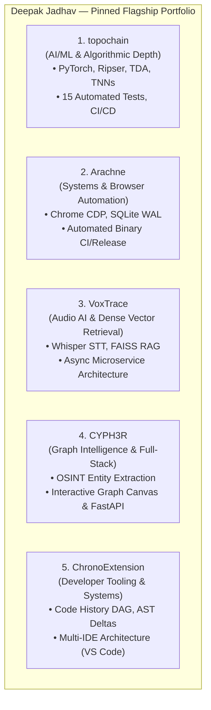

# REPOSITORY CLASSIFICATION & PORTFOLIO PRUNING MATRIX
**Developer:** Deepak Jadhav  
**GitHub Profile:** [github.com/DeepxkJadhav](https://github.com/DeepxkJadhav)  
**Strategy Goal:** Quality over Quantity. Eliminate noise, elevate real engineering, and present a bulletproof AI/ML + Backend Engineer portfolio.  

---

## 1. Classification Framework & Rubric

To build a credible GitHub presence for Senior AI/ML and Backend roles, every repository is categorized into one of five distinct operational tiers:

- **Tier A — FLAGSHIP**: Core portfolio centerpieces (3–5 projects max). Must demonstrate non-trivial architecture, real-world utility, testing, clean Git history, CI/CD, and deep technical defensibility in an interview.
- **Tier B — UPGRADE**: Substantial projects with strong potential, but requiring targeted remediation (e.g., CI/CD pipelines, Dockerization, test suites, or secret hygiene).
- **Tier C — SMALL PROJECT**: Functional proof of concept or hackathon project. Kept public to prove range, but unpinned and not positioned as primary work.
- **Tier D — ARCHIVE**: Historical artifacts, student experiments, or projects with dirty git trees (large binaries, web uploads). Preserved for record, but marked as read-only/archived.
- **Tier E — REPLACE / DELETE**: Repositories that actively harm credibility (fake activity bots, empty repos, broken branches, duplicate dumps). Must be deleted or made private immediately.

---

## 2. Complete Classification Matrix (All 22 Repositories)

| # | Repository | Language | Commits | Category | Strategic Rationale & Action |
|---|---|---|:---:|:---:|---|
| 1 | **topochain** | Python | 4 | **A — FLAGSHIP** | **Primary AI/Math Flagship.** Algorithmic supply-chain integrity engine using PyTorch, Persistent Homology (Ripser), and TNNs. Already has 15 tests, Docker, and CI. Needs commit granularity and demo polish. |
| 2 | **Arachne** | Node.js / JS | 26 | **A — FLAGSHIP** | **Primary Systems Flagship.** Headless web research engine with direct Chrome CDP socket control, SQLite WAL storage, and automated GitHub binary release CI. Demonstrates systems engineering. |
| 3 | **VoxTrace** | Python | 1 | **A — FLAGSHIP** | **Primary Audio AI Flagship.** Whisper STT + FAISS vector search RAG pipeline. High commercial appeal. Must be upgraded from a single-commit prototype to an async Celery/Redis + PostgreSQL architecture. |
| 4 | **CYPH3R** | TypeScript / Python | 3 | **A — FLAGSHIP** | **Primary Full-Stack AI Flagship.** OSINT entity extraction & interactive relationship graph visualizer. Highly engaging in live recruiter demos. Needs persistent graph storage and CORS remediation. |
| 5 | **ChronoExtension** | TypeScript / HTML | 12 | **A — FLAGSHIP** | **Primary Software Engineering Flagship.** Local-first code history DAG extension across VS Code, Neovim, and JetBrains. Outstanding architectural documentation and AST/DAG design principles. |
| 6 | **Kurumi-AE** | Python / JS | 74 | **B — UPGRADE** | **Secondary Advanced Showcase.** Desktop virtual companion with 3D MMD, local IPC, and OCR. High commit volume (74 commits), but massive (345MB) with vendored binaries. Needs secret audit and asset cleanup. |
| 7 | **DeepxkJadhav** | JavaScript | 55 | **B — UPGRADE** | **Profile Storefront.** 3D Three.js header and interactive profile README. Needs accurate project links targeting only the Tier A flagships. |
| 8 | **VeilChat** | Dart / Go | 3 | **B — UPGRADE** | **Mobile / Distributed Showcase.** Encrypted mesh anti-surveillance chat with Flutter and Go server. Needs CI pipeline and end-to-end integration tests. |
| 9 | **ExtensionOS** | TypeScript | 4 | **B — UPGRADE** | **Tooling Showcase.** Browser extension with multi-LLM routing (Groq, Together, Ollama). Useful practical utility; needs test harness and CI. |
| 10 | **Artifind-AI-powered-Artisan-markerplace** | JavaScript | 16 | **C — SMALL PROJECT** | **Hackathon Credibility.** Gen AI Exchange hackathon submission. Keep public as evidence of competitive hackathon participation; do not pin. |
| 11 | **GhostVision** | Python | 1 | **C — SMALL PROJECT** | **Security Microservice.** ML anomaly detection for cyber threats. Clean up `.pyc` files, add `.gitignore`, and preserve as a lightweight microservice demo. |
| 12 | **EdgeSim** | Python | 3 | **C — SMALL PROJECT** | **Research Prototype.** Offline casino reinforcement learning simulation suite. Clean up compiled bytecode and preserve as an algorithmic experiment. |
| 13 | **NeuroNosh** | Python | 16 | **D — ARCHIVE** | **Student Experiment.** Streamlit diet recommender with committed `.pkl` binaries and flat CSVs. Archive or rewrite completely into a modern FastAPI/pgvector nutrition API. |
| 14 | **DriveGuard** | Python | 5 | **D — ARCHIVE** | **Dirty Git Tree.** Road safety CV project with raw `.mp4` video (>100MB) and `.zip` files tracked directly in git history. Web uploads. Archive. |
| 15 | **Sentient-UI** | TypeScript / Rust | 18 | **D — ARCHIVE** | **Monorepo Bloat.** 7,288 files, excessive upstream vendored dependencies (`@claude-flow/cli`). Unwieldy to defend in an interview. Archive or keep as secondary reference. |
| 16 | **Sentient-Ops** | JS / Python | 1 | **D — ARCHIVE** | **Redundant Duplicate.** Single-commit dump replicating agent prompt definitions already present in Sentient-UI. Archive. |
| 17 | **SYNAPSE-GRID** | TypeScript | 9 | **D — ARCHIVE** | **Dirty Build Tree.** Collaborative workspace with committed `.next/` build outputs and `dist/` folders via web uploads. Archive. |
| 18 | **Resume-** | None | 4 | **D — ARCHIVE** | **Static File Hosting.** Repository used solely to store a PDF resume via web uploads. Repositories should host code, not PDFs. Archive. |
| 19 | **My-Graph** | None | 43 | **E — DELETE IMMEDIATELY** | **Toxic Red Flag.** Backdated commit script artificially coloring the GitHub contribution graph. Severely damages credibility. Must be deleted. |
| 20 | **ModelStudio** | TypeScript | 0 | **E — DELETE IMMEDIATELY** | **Empty Repo.** 0 commits, 0 files. Displays as an empty shell. Delete immediately. |
| 21 | **Portfolio** | TypeScript | 4 | **E — DELETE OR REPLACE** | **Broken Branch.** 0 files on default branch. Displays as an empty repository. Delete or replace with real portfolio codebase. |
| 22 | **deepak-portfolio-anime** | None | 1 | **E — DELETE IMMEDIATELY** | **Orphan Placeholder.** 1 file (`README.md` only). Delete immediately. |

---

## 3. The Flagship 5: Comprehensive Selection Rationale

A recruiter or engineering hiring manager spends an average of **90 seconds** on a GitHub profile. Having 22 repositories with mixed quality dilutes focus. By pinning exactly **5 flagship projects**, Deepak presents a cohesive, specialized, and elite technical narrative:

### Why This Combination Wins Job Offers:
1. **Algorithmic & Math Rigor (`topochain`)**: Directly proves that Deepak understands foundational machine learning, topological invariants, and PyTorch beyond superficial API wrapper calls.
2. **Low-Level Backend & Systems Mastery (`Arachne`)**: Demonstrates direct socket manipulation (Chrome CDP), local database indexing (SQLite WAL), and CLI engineering.
3. **Applied GenAI & Vector Search (`VoxTrace`)**: Directly maps to current enterprise demands for Speech-to-Text, Whisper model deployment, embeddings, and Retrieval-Augmented Generation (RAG).
4. **Data Visualization & Graph Theory (`CYPH3R`)**: Proves full-stack capability, API design, and intuitive graph relationship modeling.
5. **Software Craftsmanship & Architecture (`ChronoExtension`)**: Highlights deep understanding of data structures (DAG vs Linear Log), compiler concepts, and developer tooling.

---

## 4. Immediate Pruning & Cleanliness Directives

### Step 1: Immediate Deletions
Execute repository deletions for:
- `My-Graph` (Delete to purge fake commits)
- `ModelStudio` (Delete empty repo)
- `deepak-portfolio-anime` (Delete 1-file orphan)
- `Portfolio` (Delete broken empty repo or re-initialize with working code)

### Step 2: Repositories to Archive (Mark as Read-Only)
In GitHub Settings → General → Danger Zone → "Archive this repository":
- `DriveGuard`
- `Resume-`
- `Sentient-Ops`
- `SYNAPSE-GRID`
- `Sentient-UI` (or keep unpinned)
- `NeuroNosh` (unless chosen for complete v2 rewrite)

### Step 3: Repositories to Feature (Pinned Repositories)
Pin the following 5 repositories on the GitHub profile:
1. `topochain`
2. `Arachne`
3. `VoxTrace`
4. `CYPH3R`
5. `ChronoExtension`
